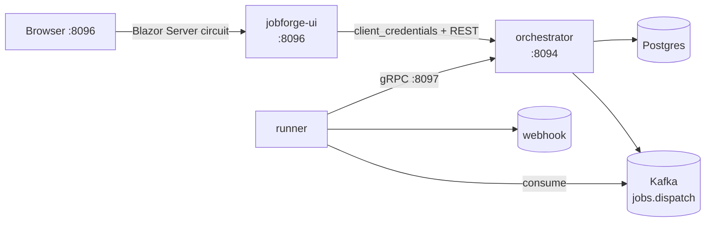

# jobforge-ui

[](https://github.com/TiagoR85/jobforge-ui/actions/workflows/ci.yml)
[](https://github.com/TiagoR85/jobforge-ui/releases)
[](LICENSE)

Blazor Server console for the **jobforge** family, built on the DashboardTheKingThePower shell, plus the hub `docker-compose.yml` that boots the whole demo: create and schedule HTTP jobs, run them on demand, watch executions stream back — all through the orchestrator's REST API as the OIDC confidential client `jobforge-console`.



## Status

Third and final repository of the jobforge family (spec §12–§19): orchestrator and runner are tagged `v1.0.0`, and this repo is the **demo hub** that composes all three from a clean clone. The console is now **v1.1.0**: dashboard shell, overview, operations page and PT-BR/EN UI.

## Quickstart (≤5 min, Docker required)

```powershell
Copy-Item .env.example .env
# edit .env → set OIDC_CLIENT_SECRET=<any secret>
docker compose up --build -d
curl http://localhost:8096/health/live   # 200
# open the console
start http://localhost:8096
```

The stack: orchestrator `:8094` (REST) + `:8097` (gRPC HTTP/2), runner `:8095`, console `:8096`, postgres `:5432`, redis `:6379`, kafka `:9092`. Orchestrator and runner are built from their `v1.0.0` tags (git-context builds, ADR-0001).

End-to-end sanity check: create a job (name + webhook URL such as `http://orchestrator:8094/`), it executes within seconds and appears as `succeeded` under **Executions**.

## Routes

| Route | Content |
|---|---|
| `/` | overview: KPIs, hourly executions chart, status donut, latest executions |
| `/jobs` | job definitions, name search, last execution badge, **Run now**, **Disable** (confirmed) |
| `/jobs/new` | schedule form with cron presets and next-run preview (Cronos, UTC) + fresh `Idempotency-Key` per submit |
| `/executions` | paginated table, status filter (`?status=` syncs to the URL), auto-refresh 5s (polling) |
| `/executions/{id}` | lifecycle timeline: scheduled/started/finished, attempt, HTTP status, duration, error |
| `/executions?status=dead` | dead-letters view (same page — no duplicate screen) |
| `/operations` | orchestrator health, API base URL, OIDC client, scopes, Prometheus link |

## Configuration

| Key | Default (appsettings) | Purpose |
|---|---|---|
| `JobForge:BaseUrl` | `http://localhost:8094` | orchestrator REST origin (token endpoint derived: `/connect/token`) |
| `JobForge:ClientId` | `jobforge-console` | confidential OIDC client |
| `JobForge:ClientSecret` | *(empty — fail-fast)* | injected via `OIDC_CLIENT_SECRET` / `JobForge__ClientSecret` |
| `JobForge:Scope` | `jobs:read jobs:write` | requested scopes |
| `Ui:RefreshSeconds` | `5` | executions auto-refresh interval |

UI language: PT-BR (default) and EN, switched in the header and persisted in a cookie.
Styling: Tailwind CSS 4 compiled locally (`npm run build:css` in `src/JobForge.Ui`);
the generated stylesheet is committed, so the container image needs no Node.
Charts: Blazor-ApexCharts (basic area/donut features — no premium licence required).

Reusing this console for another application: deploy another container with
`JobForge__BaseUrl`, `JobForge__ClientId` and `JobForge__ClientSecret` pointing at that
orchestrator (the OIDC client needs `jobs:read` and `jobs:write`). No code change needed.

Health: `/health/live` (self), `/health/ready` (probes the orchestrator). Logging: NLog 6 JSON console (`svc=jobforge-ui`, override with `SERVICE_NAME`). No `/metrics` here — metrics live in orchestrator (`:8094/metrics`) and runner (`:8095/metrics`).

## Running tests

```powershell
dotnet test tests/JobForge.Ui.Tests -p:CollectCoverage=false   # fast loop
dotnet test tests/JobForge.Ui.Tests                             # with coverage (CI gate ≥80%)
```

bUnit + WireMock only — no containers needed.

When changing styles:

```powershell
cd src/JobForge.Ui; npm ci; npm run build:css
```

## Decisions

- [ADR-0001](docs/adr/ADR-0001-hub-git-context.md) — hub compose with git-context builds pinned to `v1.0.0`
- [ADR-0002](docs/adr/ADR-0002-confidential-client-and-polling.md) — confidential client, in-memory token, 5s polling
- [ADR-0003](docs/adr/ADR-0003-data-testid-contract.md) — `data-testid` as the stable test contract
- [ADR-0004](docs/adr/ADR-0004-dashboard-shell-copy.md) — shell copied from the dashboard, no shared library

## Known deviation

The orchestrator stores **one row per execution** (status transitions overwrite it), so `/executions/{id}` shows the lifecycle timeline of that row — attempt, HTTP status, duration and error of the last state — rather than a per-attempt history table. Per-attempt history joins the backlog below once the orchestrator keeps an attempts table.

## Backlog

DLQ replay from the UI · retry-topics · mTLS on the gRPC stream · compose profiles for a VPS · refresh tokens · full OTel traces · cron ticks <30s · dependent jobs (DAG) · multi-tenant · published-outbox purge · per-attempt execution history.

## About this repository

This repository is part of a personal study project (the "github-portfolio-dotnet" portfolio). It was built with heavy use of AI-assisted development tools, but it is held to production standards on purpose: automated tests with a coverage gate, CI on every push, fail-fast configuration, structured logging, and honest documentation of trade-offs. It is not affiliated with any employer or client.

## License

MIT — see [LICENSE](LICENSE).